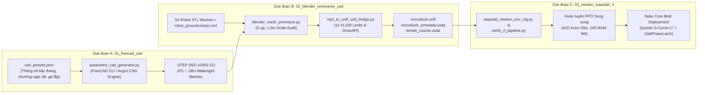

# LỘ TRÌNH NGHIÊN CỨU & HƯỚNG DẪN VẬN HÀNH PIPELINE (RESEARCH ROADMAP & OPERATIONS GUIDE)

**Dự án:** End-to-End Sim-to-Real Pipeline cho Robot hai chân Microduck (800g, 25cm, 14 bậc tự do Dynamixel XL330)
**Kiến trúc:** Single-Model Argon Pipeline (`01_freecad_cad` $\rightarrow$ `02_blender_omniverse_usd` $\rightarrow$ `03_newton_isaaclab_rl`) tích hợp Bộ điều phối Phân cấp **Neko Core (Embodied Mixture-of-Experts)**.

---

## 1. TỔNG QUAN KIẾN TRÚC PIPELINE ĐÃ TRIỂN KHAI

Toàn bộ luồng công việc từ thiết kế hình học tham số (CAD), chuẩn hóa tài sản 3D (OpenUSD / URDF), cho đến huấn luyện học tăng cường (RL) trên nhân vật lý GPU **NVIDIA Warp (`mjlab` / Newton)** đã được tự động hóa thông qua 3 mô-đun cầu nối:



---

## 2. HƯỚNG DẪN VẬN HÀNH NHANH (QUICK-START COMMANDS)

### 2.1. Chạy toàn bộ Pipeline từ đầu đến cuối bằng 1 lệnh duy nhất
```bash
PYTHONPATH="" uv run python run_argon_pipeline.py --stage all
# Hoặc sử dụng Makefile:
make all
```
Khi lệnh chạy xong, toàn bộ nhật ký và báo cáo kiểm định tự động được ghi vào:
- `docs_and_logs/pipeline_execution.log`
- `docs_and_logs/asset_validation_report.json`
- `docs_and_logs/stage_c_rl_verification.json`

### 2.2. Chạy riêng lẻ từng giai đoạn

1. **Giai đoạn A — Sinh mô hình CAD tham số (`.STEP`, `.STL`, `.OBJ`):**
   ```bash
   PYTHONPATH="" uv run python 01_freecad_cad/parametric_cad_generator.py
   ```
   - Để thay đổi chiều cao bậc thang (ví dụ thử nghiệm bậc 4.0 cm), chiều rộng hành lang hoặc kích thước chướng ngại vật: chỉnh sửa trực tiếp tệp `01_freecad_cad/cad_presets.json` rồi chạy lại lệnh trên.
   - Đầu ra nằm tại `01_freecad_cad/exports/`:
     - `nc_high_stairs_course.{step,stl,obj}`
     - `step_over_hurdles.{step,stl,obj}`
     - `microduck_beak_bumper_bracket.{step,stl,obj}`

2. **Giai đoạn B — Kiểm toán Mesh & Xuất `microduck.urdf` + OpenUSD (`.usda`):**
   ```bash
   PYTHONPATH="" uv run python 02_blender_omniverse_usd/blender_mesh_processor.py
   PYTHONPATH="" uv run python 02_blender_omniverse_usd/mjcf_to_urdf_usd_bridge.py
   ```
   - Đầu ra nằm tại `02_blender_omniverse_usd/usd_assets/`:
     - `microduck.urdf`: Tệp URDF chuẩn hóa 16 khâu (`links`) và 14 khớp servo (`joints`) với giới hạn mô-men xoắn `0.963 Nm`, vận tốc `9.95 rad/s`.
     - `microduck_simready.usda`: Tài sản OpenUSD SimReady tích hợp `PhysicsArticulationRootAPI`, `PhysicsRigidBodyAPI`, `PhysicsMassAPI`, `PhysicsCollisionAPI`, `PhysicsRevoluteJoint` và `PhysicsDriveAPI:angular`.
     - `terrain_course.usda`: Cảnh tổng hợp OpenUSD kết nối robot Microduck và địa hình tham số từ Giai đoạn A.

3. **Giai đoạn C — Kiểm chứng Cầu nối Vật lý GPU Warp, Hợp đồng 61D & Neko Core:**
   ```bash
   PYTHONPATH="" uv run python 03_newton_isaaclab_rl/verify_rl_pipeline.py
   ```

---

## 3. HƯỚNG DẪN HUẤN LUYỆN CHÍNH SÁCH RL & TINH CHỈNH THAM SỐ

### 3.1. Quy trình chuẩn trước mỗi đợt huấn luyện dài (Smoke Test bắt buộc)
Luôn chạy kiểm thử khói 5 vòng lặp với 64 môi trường để đảm bảo không có lỗi cấu hình hoặc `NaN`:
```bash
# 1. Bài toán Leo cầu thang cao 3.5cm (High Stairs Curriculum)
PYTHONPATH="" uv run train Mjlab-Stairs-Climb-Microduck --env.scene.num-envs 64 --agent.max_iterations 5

# 2. Bài toán Tìm & Nhặt vật mù POMDP (Heading-Lock / Virtual Compass)
PYTHONPATH="" uv run train Mjlab-Fetch-Microduck --env.scene.num-envs 64 --agent.max_iterations 5

# 3. Bài toán Dẫn & Đá bóng (Contact-Rich Ball Dribbling)
PYTHONPATH="" uv run train Mjlab-Ball-Kick-Microduck --env.scene.num-envs 64 --agent.max_iterations 5
```

### 3.2. Huấn luyện chính thức trên GPU (4096 môi trường song song)
```bash
# Huấn luyện chính sách leo cầu thang 6000 vòng lặp (4 giai đoạn curriculum: 0 / 1500 / 3000 / 4500)
PYTHONPATH="" uv run train Mjlab-Stairs-Climb-Microduck --env.scene.num-envs 4096 --agent.max_iterations 6000

# Xuất checkpoint tốt nhất sang ONNX (bắt buộc dùng scripts/export.py để đóng gói bộ chuẩn hóa)
PYTHONPATH="" uv run scripts/export.py Mjlab-Stairs-Climb-Microduck --wandb-run-path <entity/project/run_id>
```

### 3.3. Chạy thực nghiệm đối chứng Neko Core (Ablation Benchmark)
Để tái lập bảng số liệu khoa học so sánh 4 phương pháp chuyển giao kỹ năng (`1_HardSwitch`, `2_Linear_C0`, `3_Quintic_C2`, `4_Neko_Full`):
```bash
PYTHONPATH="" uv run python scripts/benchmark_neko_core_ablation.py
```
Kết quả định lượng sẽ được cập nhật tại `results/neko_core_ablation.csv` và `results/neko_core_ablation_summary.json`.

### 3.4. Chạy bộ kiểm thử hồi quy toàn dự án (Regression Suite)
```bash
PYTHONPATH="" uv run --with pytest pytest tests/
```

